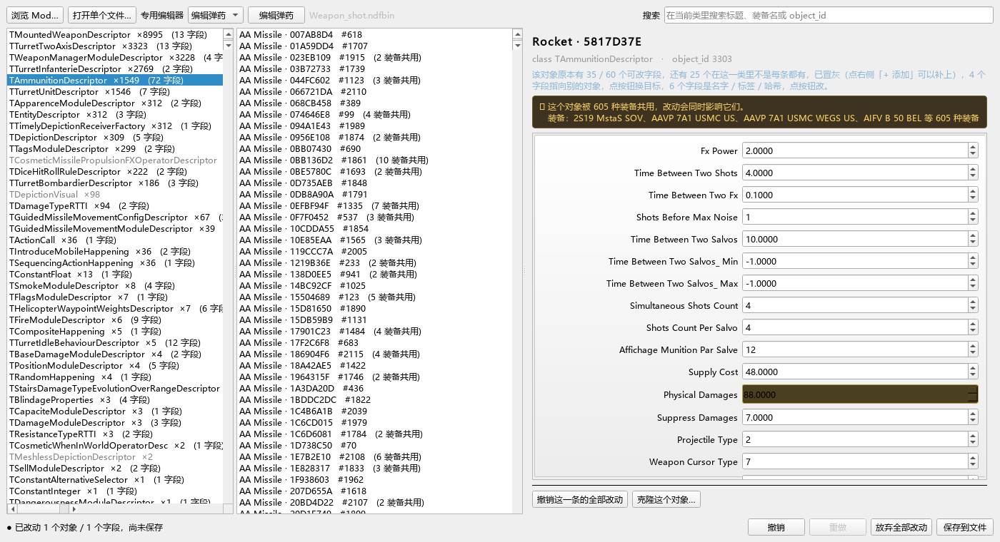

# Warno Ndfbin Editor

**直接编辑 WARNO 的 `.ndfbin` 数据文件。** 不碰 NDF 脚本，只做一件事：
把游戏数据文件里的数值和指向关系改掉，再安全地写回去。



面向**会开 Excel、但不知道 `ndfbin` 是什么**的 mod 玩家。

---

## 下载即用

到 [Releases](../../releases) 下载 `Warno Ndfbin Editor v0.2.exe`
（MD5 `b668e3e655b16762924a79f465f9238e`），双击。

**不需要 Python，不需要装任何库** —— 运行时依赖、图标、界面文字表都在那一个
文件里（约 43 MB）。首次启动约 1.5 秒，单文件包要先把自己解压到临时目录。

> **首次运行可能弹 Windows SmartScreen 的蓝色警告。** 这个 EXE 没有代码签名
> 证书，未签名程序都会触发它，不代表文件有问题 —— 点「更多信息」→「仍要运行」
> 即可；在意的可以先核对上面的 MD5。

也可以把文件路径直接带在参数上打开：

```bat
"Warno Ndfbin Editor v0.2.exe" "D:\...\Gen\NDF\GFX\Weapon.ndfbin"
```

## 能改什么

打开之后是三栏：**类 → 对象 → 字段**。右侧字段面板按**这个对象实际拥有的字段**
生成，没有的字段不占位置 —— 不会让你以为「射程 0」是真值。

| 字段类型 | 怎么改 |
|---|---|
| `int` / `float` / `bool` | 直接输入。`GRU` 结尾的字段旁显示 `≈ km` 换算（只做显示，存的还是 GRU） |
| 指向一个对象 | 长按钮进那个对象看内容，短按钮换目标 |
| 指向一串对象 | 逐项换目标、**增删项**、调顺序、跳过去看那一项 |
| 字符串（如 `ImpactHappening`） | 从文件自带的字符串表里搜着选 |
| 标签列表（如 `TraitsToken`） | 加 / 改 / 删 / 上移下移 |
| 哈希（如 `Name` / `Caliber`） | **照抄**同类对象用过的值 |

候选列表按**被引用次数**排序，不是字母序：字符串表有五千多项，而同类对象真正用
过的只有几十个。哈希那里给的不是输入框，而是「**300 个同类对象在用这个值**」这样
的清单 —— 哈希不可逆、词典是加密的，没有「输入名字」这条路。

**不会显示的**：数组整体、`loc_hash`、`guid`。改了只会弄坏 mod。

类多的文件（`Depiction.ndfbin` 145 个类、`Unit.ndfbin` 102 个）左栏顶部有
**类名搜索框** —— 输入任意片段即可过滤，不区分大小写。

还有几件为「改错要能退」准备的东西：

- **撤销 / 重做**（`Ctrl+Z` / `Ctrl+Y`）—— 批量改 150 条是**一步**，一次全退
- **保存前逐字段对照** —— 列出对象、字段、改前、改后
- 原子写入 + 自动 `.bak` 备份

### 专用页：不用先认识类名

工具栏的下拉框里有第二个入口，面向「我知道要改什么，但不知道它在哪个类里」：

| 页面 | 打开的文件 | 做什么 |
|---|---|---|
| **编辑弹药** | `Weapon.ndfbin` | 按字段值筛弹药（如「对地射程 = 1925」），批量改 |
| **编辑牌组属性** | `Pawn.ndfbin` | 将军模式营的战略属性：按国家/师/团筛，改行动点、移动方式、部队类型、支援半径与防空半径 |

牌组属性页的批量改带 **clone-on-write**：改动落在共享描述器上时，只命中一部分
就自动克隆，没命中的营一个字节不动。它还能给本来没有某个属性的营**补上**那个
属性（例如给步兵营加炮兵支援半径）。

> 牌组属性页的实际改动已在游戏内验证通过。

## 从源码运行

```bat
启动NdfBin编辑器.bat
```

或手动：

```bat
python -m venv .venv
.venv\Scripts\pip install -r requirements.txt
python run_weapon_editor.py
```

需要 Python 3.10+，以及 `PySide6`、`zstandard`、`lz4`。

## 跑测试

单个文件：

```bat
python -m tests.test_reflist_edit
```

整套跑一遍：

```bat
for %f in (tests\test_*.py) do @python -m tests.%~nf
```

**这套测试跑在真实的 WARNO 文件上** —— 那正是它有意义的原因，也是它的前提。
它不写死任何路径：样本 mod 由 `ndfbin_decks.io.modlocator` **发现**，找不到就
`SKIP` 并列出本机有哪些 mod，而不是抛一串 traceback。

所以：**没装 WARNO 的机器上，大部分测试会 SKIP，这是预期行为，不是失败。**
默认样本是创意工坊的 `3388575848`（一个含 Weapon / Unit / Deck / Division 的完整
AGF mod）；要换样本，改 `tests/_env.py` 里的 `SAMPLE`。

## 项目结构

```
ndfbin_decks/
  core/          格式读写引擎 —— CNDF 容器、zstd / lz4 编解码、原子写入
  ndfedit/       通用 .ndfbin 编辑器（本项目的主体）
  io/            mod 定位、游戏本地化词典、数据来源判定
  i18n/          编辑器自身界面的翻译（与游戏本地化无关）
  app/  edit/    早期「牌组专用编辑器」的界面与批量编辑（见下）
tests/           25 个测试文件，全部针对真实游戏文件
tools/           开发期的勘查脚本与文档生成器
doc/             使用说明、格式规格、字段地图
assets/          图标与其生成脚本
```

`ndfbin_decks/app` 与 `edit` 是**前身**：更早的版本只编辑牌组。代码还在、测试也
还在跑，但 `build_exe.py` 明确把它们排除在打包之外 —— 打出来的 EXE 里只有通用
编辑器，而这一点由构建时的 `check_absent()` 每次断言，不靠人工检查。

`tools/` 是**开发期脚本**，不是给用户跑的工具：勘查格式、生成字段地图、离屏截图。
它们和测试一样用发现式路径（`tools/_src.py`），可用 `NDFBIN_SAMPLE_MOD` 指向别的 mod。

## 自己打包

```bat
python -m venv .venv-build
.venv-build\Scripts\pip install -r requirements.txt -r requirements-build.txt
.venv-build\Scripts\python.exe build_exe.py
.venv-build\Scripts\python.exe verify_exe.py 0.2
```

构建写 `dist_0.2/`（候选），**不碰 `dist/`**（已发布的那一份）。验证通过后手工提升：

```bat
copy "dist_0.2\Warno Ndfbin Editor v0.2.exe" "dist\"
```

`verify_exe.py` 会真的启动那个 EXE、读它写出的日志、**把一个真实 `.ndfbin`
交给它打开**，再核对窗口标题与图标。只证明「进程起来了」是不够的 —— 一个缺
codec 的包照样能启动，它会在用户双击第一个文件时才失败。

## 文档

| 文件 | 内容 |
|---|---|
| [使用说明](doc/NDFBIN编辑器使用说明.md) | 面向玩家，含 17 张界面截图 |
| [CNDF 格式规格](doc/CNDF格式规格.md) | 二进制容器的结构 |
| [牌组属性页设计与实测](doc/AG牌组属性编辑-实现计划.md) | 第二个专用页的数据依据、坑与验收 |
| [立刻可推进的工作](doc/立刻可推进的工作.md) | 当前待办与实测数据 |
| [ToDoList](doc/ToDoList-Ndfbin编辑器.md) | 阶段划分与风险登记 |

`doc/` 里的「**勘查报告**」类文件不随仓库分发（`.gitignore` 已排除）：它们引用某个
具体 mod 的编制、单位数与命名习惯，是开发笔记，不是用户文档。

## 许可

Apache License 2.0，见 [LICENSE](LICENSE)。

## 免责

非官方工具，与 Eugen Systems 无关。WARNO 及相关名称是 Eugen Systems 的商标。
改动 mod 文件前请自行备份；编辑器会写 `.bak`，但那不是万无一失的保证。
