# NDFBIN 编辑器 · 使用说明

面向**会开 Excel、不知道 ndfbin 是什么**的 mod 玩家。  
不改 NDF 脚本，只做一件事：**改游戏数据文件里的数值和指向关系**。

> 已从「只能改 Weapon.ndfbin 的弹药」扩展为**打开任意 .ndfbin**；  
> 能改的不只是数字，还包括「这个字段指向哪个对象」。

**能改什么**：`int` / `float` / `bool`，加上两类指向别的对象的字段  
（做成选择框——你确实能理解「这块装甲是哪一档」）。  
数组、`loc_hash`、`guid` 不显示，改了只会弄坏 mod。

**Unit.ndfbin 多一块实体概览**：实体类自己身上一个数值都没有，  
所以血量 / 装甲 / 速度是从它引用的模块里捞出来聚合的。


---

## 启动

### 捷径：双击就用（推荐）

下这个文件，双击：

```
Warno Ndfbin Editor v0.1.exe      约 43 MB，单文件
```

**不需要装 Python，不需要装任何库。** 依赖（PySide6、zstandard、lz4）和
图标、界面文字表都已经塞进这一个文件里了。

第一次启动约 **2 秒**——单文件包每次都要先把自己解压到一个临时目录，
这是它唯一比「文件夹版」慢的地方。

想直接打开某个文件，把路径带在参数里：

```bat
"Warno Ndfbin Editor v0.1.exe" "D:\Steam\steamapps\workshop\content\1611600\3388575848\Gen\NDF\GFX\Weapon.ndfbin"
```

EXE 走到哪都认自己的位置，放在桌面、U 盘、Mod 目录旁边都一样。

### 从源码跑（开发用）

双击 `启动NdfBin编辑器.bat`（会自己找可用的 Python），或者手动：

```bat
python run_weapon_editor.py
python run_weapon_editor.py "D:\...\Gen\NDF\GFX\Weapon.ndfbin"
```

需要 Python 3.10+ 与 `PySide6`、`zstandard`。启动器按顺序探测：  
本项目 `.venv` → `NdfbinDecksEditor\.venv`（旧牌组编辑器那个，已装好）→ 系统 `python`。

> **已经有 NdfbinDecksEditor 的机器，一个包都不用装。**

### 打开之后

两个入口：

- **「浏览 Mod…」** —— 先选 Mod 再选文件，Mod 作者走这条（见下一节）
- **「打开单个文件…」** —— 直接给 `.ndfbin` 路径

### 出错了先看这两个文件

打包版没有控制台窗口，所以出问题不会弹一堆红字。它把话写在：

```
%LOCALAPPDATA%\WarnoNdfbinEditor\app.log       每次启动一行
%LOCALAPPDATA%\WarnoNdfbinEditor\crash.log     崩了才有，含完整堆栈
```

崩了的时候程序自己会弹一个框告诉你路径。把这个文件发给作者就能定位。

---

## 从 Mod 开始（推荐入口）

点顶栏的 **「浏览 Mod…」**：左边选 Mod，右边挑它里面的文件，双击就打开。

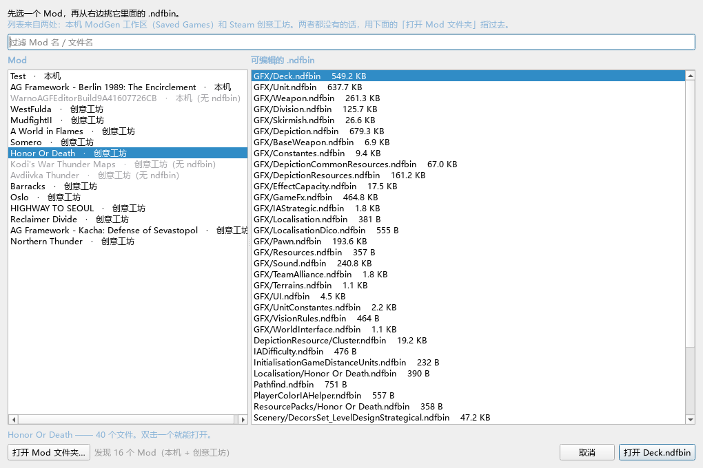

### 为什么要多这一级

NdfbinDecksEditor 选完 Mod 就直接开 `Deck.ndfbin`，因为那个编辑器只编牌组。
  
这个编辑器要改 Mod 里的**任意** ndfbin（`Unit` / `Weapon` / `Depiction` …），
  
所以选完 Mod 还得列一下它有什么。

### 左边那列的 Mod 是从哪来的

两种来源，都已经自动找好：

| 来源   | 位置                                                  | 是什么               |
| ---- | --------------------------------------------------- | ----------------- |
| 本机   | `Saved Games/EugenSystems/WARNO/mod/<名称>/`          | 你在 ModGen 里导出的工作区 |
| 创意工坊 | `<Steam库>/steamapps/workshop/content/1611600/<id>/` | 你订阅的 Mod          |

**订阅的 Mod 不会被复制到本机工作区**，只认后者会让「我订阅的 Mod 怎么不在列表里」
  
成为每个人的第一个问题。所以两者都列。

Steam 装在别的盘也没关系——通过 `libraryfolders.vdf` 找，不写死 C 盘。

### 灰掉的条目

标着「（无 ndfbin）」的是**里面没有能改的文件**——通常是还没在 ModGen 里
  
导出过（只有 NDF 源码），或者数据用别的方式打包（不少地图 Mod 就是这样）。
  
它们仍然可以点选，tooltip 里写了原因。

### 找不到 Mod 怎么办

点 **「打开 Mod 文件夹…」**，指到 Mod 目录（含 `Gen/NDF` 的那一层）。
  
自动发现只能看 Steam 和本机工作区，这四种情况都得靠它：

- Mod 在 U 盘上或从压缩包里解出来的
- 另一个 Windows 账户的工作区
- 第二个 Steam 库（`libraryfolders.vdf` 解析失败的）
- 你只是想直接开一个目录里的 ndfbin

### 只想开一个文件

点 **「打开单个文件…」**，直接给 `.ndfbin` 路径——不经过 Mod。
  
顶栏标签这时显示文件名；从「浏览 Mod…」进来的则显示
  
`Mod 名 · GFX/Unit.ndfbin`，鼠标悬停能看到完整路径。

### 一个容易踩的坑：同名的两份

实测有的 Mod 里同时存在 `Gen/NDF/Deck.ndfbin` 和
  
`Gen/NDF/GFX/Deck.ndfbin`。**游戏读的是 `GFX/` 那份**，
  
所以列表把 `GFX/` 里的排在前面，而且显示时会带上目录
  
（`GFX/Deck.ndfbin` 对 `Deck.ndfbin`），不会让你选错。

---

## 界面：三栏，改哪个文件都通用

```
┌────────────┬──────────────┬──────────────────────┐
│ 类列表│ 对象列表     │ 字段面板              │
│ 57 个类     │ 该类的实例   │ ├ 实体概览（血量/装甲/速度）│
│ 来自 PROP 表│ 名字可读     │ └ 本对象的字段         │
│            │ 可搜索       │    改完标黄            │
└────────────┴──────────────┴──────────────────────┘
  [ 已改动 N 个对象 ]  [撤销] [重做] [ 放弃改动 ] [ 保存到文件 ]
```

打开任何 `.ndfbin` 都能用。可改字段由**文件自带的 PROP 表自动发现**，  
不需要为每个文件维护白名单。

左栏顶部有**类名搜索框**。类多的文件（`Depiction.ndfbin` 145 个类、
`Unit.ndfbin` 102 个）光靠滚动找太慢 —— 输入任意片段即可过滤，不区分大小写：
在 `Unit.ndfbin` 里搜 `Descriptor` 从 102 个类缩到 96 个，搜 `Weapon` 只剩 1 个。

过滤不会打断你正在做的事：当前类如果还在结果里就保持选中，被滤掉了才落到
第一个。筛到 0 个时列表给一行「没有匹配的类」，状态栏也会写明「共 N 个类」，
省得以为文件坏了。换文件时过滤自动清空。

对象列表里的名字也是从文件里推断出来的，不是 `#343` 这种裸编号——  
见「引用字段」一节的标签回退规则。


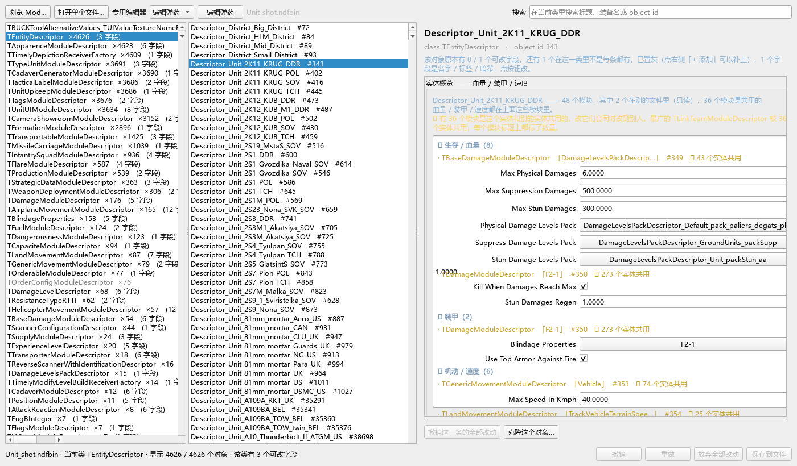

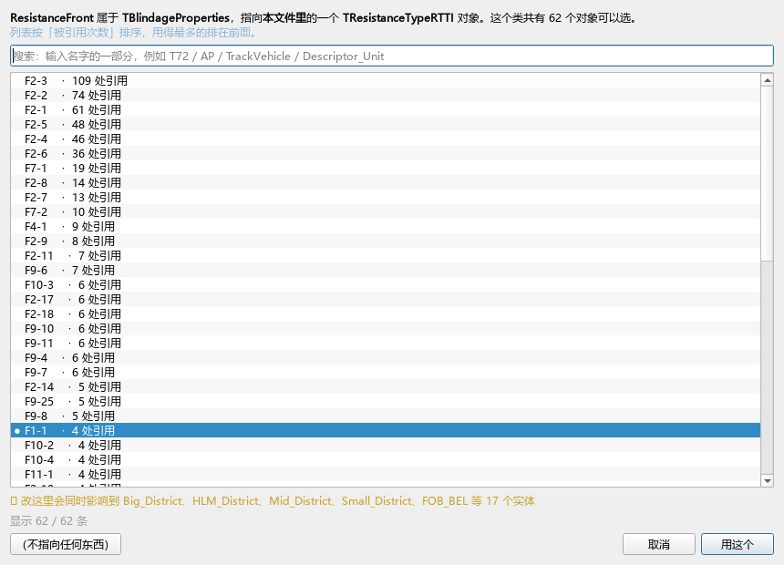

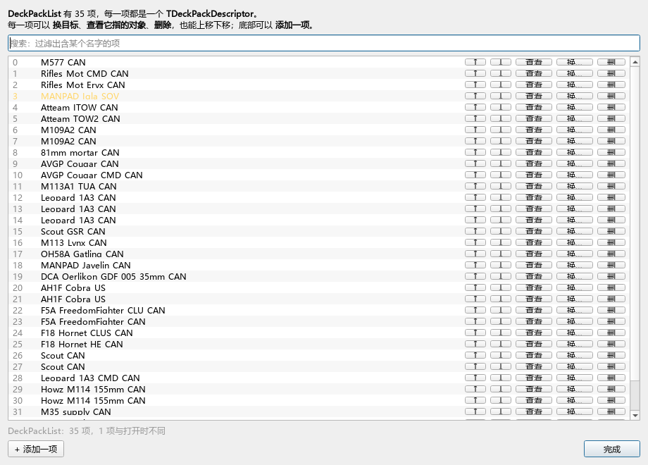

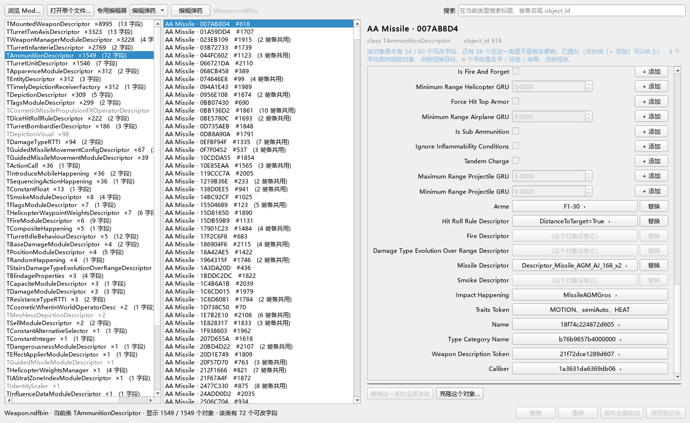

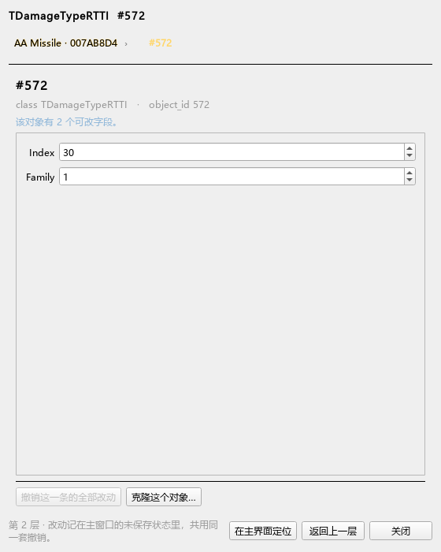

### 各文件实测规模

| 文件                    | 对象数    | 类数  | 含可改字段的类 |
| --------------------- | ------ | --- | ------- |
| Weapon.ndfbin         | 24,168 | 57  | 40      |
| Unit.ndfbin           | 56,223 | 102 | 47      |
| Deck.ndfbin           | 59,947 | 5   | 5       |
| Depiction.ndfbin      | 77,923 | 145 | 74      |
| Division.ndfbin       | 6,282  | 4   | 2       |
| Skirmish.ndfbin       | 1,416  | 82  | 44      |
| EffectCapacity.ndfbin | 598    | 48  | 34      |

完整清单见 [`通用字段地图.md`](通用字段地图.md)（脚本生成，2194 行，覆盖 mod 目录全部 12 个文件）。

---

## 改错了怎么办：撤销

底栏的 `[撤销]` `[重做]`，或直接按 `Ctrl+Z` / `Ctrl+Y`（`Ctrl+Shift+Z` 同重做）。

**所有能改的东西都能撤销**——标量、引用目标、一串引用里的某一项、
  
补加的字段、批量改的 150 条，一个不漏。

### 三条要知道的规则

**一、批量改是一步。** 一次改了 150 条，`Ctrl+Z` 一下全部退回，
  
不需要按 150 次。

**二、连续的微调会合成一步。** 用方向键连点 20 下把射程从 1925 调到
  
2100，退一步就回到 1925，而不是要退 20 次。改动发生在同一个字段上、
  
且间隔不到 1.5 秒时算作「还在调这一个」。改完 A 再改 B 再回来改 A 是三步。

改出去又改回原样的（改完发现不对、又填回原来的数）**不会在历史里留下记录**
  
——净效果为零的步骤会被丢掉。

**三、撤销只退到「打开文件时」。** 换文件、点「放弃全部改动」、
  
或者保存之后，记录就清空了。保存是提交点，不是一次可撤销的操作——
  
文件已经写进磁盘了，要回退得用同目录的 `.bak`。

### 按钮上的提示会告诉你接下来退什么

把鼠标停在 `[撤销]` 上，它会说要退掉哪一处：

```
撤销「M109A2 CAN ▸ Max Physical Range GRU」（Ctrl+Z）
```

按钮灰着就说明没得退了（tooltip 会写「没有可撤销的改动」）。

### 「撤销这一条的全部改动」也能退回来

字段面板上那个按钮（只退当前这一个对象）也是一步历史。
  
按了之后想反悔，`Ctrl+Z` 就回来了。

> 顺带说一个修掉的老毛病：这个按钮以前**只改数据不刷新界面**——
>   
> 数据退回去了，底部却还写着「已改动 1 个对象」，保存按钮也还亮着，
>   
> 按下去因为实际没有改动而什么都不做。现在它既刷新界面，也记进历史。

---

## 关于弹药名称（重要）

早期版本把装备名（`2S19 MstaS SOV`）当成弹药标题，这是**张冠李戴**——  
同一门炮能配多种弹药，一种弹药也可能被多种装备共用（实测一种被 **605 种装备**引用）。

**弹药自己的 `Name` 字段用不了。** 它是 `loc_hash`（`type_id == 0x1d`，8 字节哈希）：

```text
Name     t=0x001d hex=cc7739d752499c08
Caliber  t=0x001d hex=e4339110488e4d03
```

要还原成文本必须反查游戏本地化词典。已实测：Test mod 的 12 个 `.dic`  
确实是「hash → UTF-16 文本」映射，但表头是**哈希表**而非顺序表，  
且 1548 个弹药 Name 一个都没命中；本体词典在 `Data\PC\<build>\*.dat` 里，已加密。

⇒ **本阶段无法就地还原弹药真名。** 硬凑一个假名字比老实显示标识更糟——  
玩家会以为那就是游戏里的名字。

现在的显示方式：

- **标题** = 弹种 + GUID 前缀，如 `Rocket · 5817D37E`
  - 弹种来自 `ProjectileType` 枚举：Shell 857 / AA Missile 345 / Rocket 257 / Missile 71 / Bomb 3
  - GUID 取自 `DescriptorId` 前 8 位，是弹药在 mod 内唯一稳定的身份
- **副标题** = `装备：2S19 MstaS SOV、AAVP 7A1 USMC US ...`（明确标注这是装备名）

---

## 关于射程字段：8 对的实测覆盖率

`TAmmunitionDescriptor` 里注册了 8 对射程字段，依次对地 / 对直升机 / 对飞机 / 对投射物。  
**实测并不是所有弹药都有**：

| 字段                          | 覆盖率   |
| --------------------------- | ----- |
| `MaximumRangeGRU`（对地最大）     | 90.2% |
| `MinimumRangeGRU`（对地最小）     | 73.8% |
| `MaximumRangeHelicopterGRU` | 28.7% |
| `MaximumRangeAirplaneGRU`   | 14.7% |
| `MinimumRangeHelicopterGRU` | 4.7%  |
| `MinimumRangeAirplaneGRU`   | 4.2%  |
| `MaximumRangeProjectileGRU` | 0.5%  |
| `MinimumRangeProjectileGRU` | 0.1%  |

所以面板**只显示当前对象实际拥有的字段**，其余置灰。面板顶部会写明：

> 该对象原本有 35 / 60 个可改字段，其中 0 个是你补加的，还有 25 个在这一类里不是每条都有（点右侧「+ 添加」可以补上）。

成因：空对空弹药不需要地面射程，对空弹药不需要对地射程，  
只有反导弹药（主动防御系统、CIWS、SAM等等）才需要「对投射物射程」。

---

## 给没有的字段「+ 添加」（低代码用户向）

**这是本编辑器最该被用到的功能，但界面只有一个很朴素的按钮。**

### 为什么需要它

NDF 里「一个类有哪些字段」不是写死的清单，而是由文件自己的 PROP 表决定。  
实际情况是：PROP 表里声明了 60 个弹药字段，但**只有一部分对象真的用了其中一部分**。  
未使用的字段不会出现在对象里——所以你会看到这种局面：

```
30mm 穿甲弹（反坦克）      有对地射程、有反导射程
155 mm 高爆弹（对地压制）    有对地射程，但反导射程那一栏是空的
```

如果你想把第二种弹药改成「也能拦截一下反坦克导弹」，  
原来的编辑器做不到——只能去改 NDF 脚本。现在点两下就能做到。

### 怎么用（三步）

1. 选中缺字段的那条弹药对象。
2. 找到那一行（它是**置灰**的），行尾会出现一个小按钮 **`+ 添加`**。
3. 点它。输入框立刻变成可编辑，值已经替你填好了，直接改数字即可。

按钮上悬停会看到解释。第一次填的值取自**同类里排中间的那个对象的值**  
（不是最大值也不是最小值，避免一上手就离谱）。改完点保存。

### 万一加错了

同一个按钮会变成 **`− 移除`**，再点一次就摘掉，恢复成「本来没有」的样子。  
点「重置改动」也是同样效果——补加的字段会被**整个摘掉**，  
而不是只恢复原值，因为原值本来就是不存在的。

### 三条需要知道的规则

| 规则                 | 说明                                                                       |
| ------------------ | ------------------------------------------------------------------------ |
| 补加的字段**游戏真的会用**    | 不是编辑器自己记的笔记。写盘后它就是文件里真实存在的属性，游戏读得到。这一点已用探针实测验证：追加属性后编码-解码往返稳定保留，其它对象零影响。 |
| 只能加**这一类已经声明过**的属性 | 如果整个弹药类都没声明过某个属性，PROP 表里就没有它的 ID，加不了——按钮会弹窗告诉你原因，不会静默失败。                 |
| 类型会替你转换            | 你在「最大射程」那栏敲 `42`，即使该字段实际是整数，也会转成 `42.0` 而不是让文件崩掉。                        |

### 怎么知道补加了多少个

- 面板顶部汇总句里写着「其中 N 个是你补加的」。
- 状态栏写着「● 已改动 X 个对象 / Y 个字段，**补加 N 个字段**，尚未保存」。
- 保存前的确认框会**单独再提醒一次**——因为这一类改动比「改了个数值」影响大，  
  万一加错字段名或加到奇怪的对象上，值得停一下想一想。

### 一句话边界

补加字段解决的是「这个属性该不该有」，**不解决「填什么值对」**。  
填进去的数值仍然要你自己懂：给防空弹加「反导射程 2000」意味着什么，  
游戏不会拦你，只有你自己负责。

---

## 克隆对象：复制一个再改

面板底部有个 **「克隆这个对象…」**。它做四件事：

1. 复制当前对象（含它全部属性）
2. **换一个新的 GUID**（见下）
3. 追加到文件末尾（对象表 + 顶层对象表一起扩）
4. 弹出一个窗口，问你要让**哪些字段改指向新对象**

第 4 步可以不勾，克隆体照样留在文件里，之后在各自的字段面板里用「替换」慢慢指。

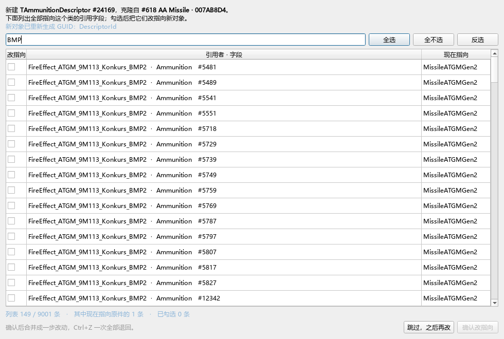

### 那个多选窗口

标题写清「新建的是哪个、从哪克隆的」，然后**列出全部指向这个类的引用字段**。

实测一个弹药类有 **9001** 个候选实例（`TMountedWeaponDescriptor.Ammunition`
  
8995 处 + `TFireModuleDescriptor.AmmunitionForBurn` 6 处）——列全了，不收敛，
  
靠搜索和排序去找。

| 设计                  | 为什么                                                                                            |
| ------------------- | ---------------------------------------------------------------------------------------------- |
| **默认勾选**那些「现在指向原件」的 | 克隆的常见用途就是「拿原件改一改再换上去」。实测每个弹药只被 0~7 个字段引用，那几处会浮到列表最前                                            |
| 排序把「指向原件的」放最前       | 同上；而「指向别处的」也仍在列表里，想把一个全新武器指过来同样做得到                                                             |
| 每行带 `#id`           | **引用者的显示名会重名**：实测搜「BMP」命中 119 个不同对象，标题却都叫 `FireEffect_ATGM_9M113_Konkurs_BMP2`。没有 id 就分不出哪行是哪行 |
| 确认后合并成**一步**        | 勾了 5 处也是一次 `Ctrl+Z` 全部退回                                                                       |

底部随时可以「跳过」，或「全不选」。

### 新对象换什么、不换什么

| 字段                       | 类型             | 克隆时                                                 |
| ------------------------ | -------------- | --------------------------------------------------- |
| `DescriptorId`           | guid（16 字节）    | **换成新的**。实测 1548 个弹药的取值全部唯一，它是身份标识；照抄等于新对象和原件共用一个身份 |
| `Name`                   | loc_hash（8 字节） | 换不了，沿用原件的                                           |
| `Caliber`                | loc_hash       | 换不了                                                 |
| `TypeCategoryName`       | loc_hash       | 换不了                                                 |
| `WeaponDescriptionToken` | loc_hash       | 换不了                                                 |

**为什么 loc_hash 换不了**：它是从文本算出来的单向哈希，不可逆（试过约 40 种哈希 ×
  
6 种编码都复现不出）。所以**克隆体在游戏里会显示原件的名字与口径**，编辑器里
  
没法给它起个新名。

好消息是游戏容忍重名——实测 `Name` 在 1548 个弹药里本来就有 520 个重复取值。
  
所以这不是致命问题，但你要知道克隆体的显示名和原件一样。

### 三条边界

- **克隆体只能追加在末尾，不能被删掉中间的对象**。对象编号被引用到处指着，
    
  删中间会平移后面所有编号。
- **还有引用指着克隆体时，撤销克隆会被拒绝**，并告诉你哪几处还指着它。
    
  先把那些「替换」改回去，或先撤销它们。
- **克隆本身也是一步历史**，和紧随其后的「改指向」分开，`Ctrl+Z` 可以只退其中一步。

---

## 常用字段速查（弹药类）

| 字段                               | 含义             |
| -------------------------------- | -------------- |
| `PhysicalDamages`                | 物理伤害           |
| `SuppressDamages`                | 压制伤害           |
| `ProjectileSpeedGRU`             | 弹丸速度           |
| `TimeBetweenTwoShots`            | 两发间隔（秒），越小射速越快 |
| `TimeBetweenTwoSalvos`           | 两轮间隔（秒）        |
| `ShotsCountPerSalvo`             | 每轮弹量           |
| `SimultaneousShotsCount`         | 同时弹丸数          |
| `SupplyCost`                     | 补给消耗           |
| `RadiusSplashPhysicalDamagesGRU` | 溅射物理伤害         |

改射速时 `TimeBetweenTwoShots` **不要设 0**，游戏可能异常，建议不低于 0.05。

字段名不做中文翻译：它们来自 NDF 本身，游戏里玩家看到的也是英文，  
两边对得上才不会找错字段。

---

## 安全性

| 机制    | 行为                               |
| ----- | -------------------------------- |
| 内存态编辑 | 不点保存就绝不动文件                       |
| 自动备份  | 首次保存生成 `.bak`，是**原始文件**，永不覆盖     |
| 写前校验  | 重建后重新解析一遍，失败拒写，文件一个字节不动          |
| 过期保护  | 文件被别的程序改过 → 拒绝保存，不会覆盖别人的改动·      |
| 原子替换  | 临时文件 + fsync + replace，断电不留半截坏文件 |
| 单条撤销  | 「撤销这一条的全部改动」                     |
| 全部放弃  | 「放弃全部改动」重载文件                     |

想完全还原：把 `.bak` 改回原文件名。

### 暴露什么，为什么

编辑器开放四类东西：

| 类型       | 例子                                         | 怎么改      |
| -------- | ------------------------------------------ | -------- |
| 数值       | `MaxPhysicalDamages` = 6.0                 | 填数字 / 打勾 |
| 引用（本文件）  | `BlindageProperties` → 某块装甲                | 点按钮选目标   |
| 引用（资源路径） | `TerrainSpeedFactors` → `$/GFX/Terrains/…` | 点按钮选路径   |
| 一串引用     | `DeckPackList` → 35 个槽位                    | 点开逐项换目标  |


**不开放**：数组、`loc_hash`、`guid`——它们的值没有可理解的语义，  
改了只会让 mod 崩溃。名称里带 `DescriptorId` / `Guid` / `Token` /  
`Texture` / `Mesh` / `Path` 的一律排除，那些是资源标识。

> 注意 `Id` 只有在**词尾**才算标识符。`ResistanceSides`（装甲侧面）  
> 里也有 "id"，但它是货真价实的数值字段，不该被挡掉——这个区分  
> 是实测中踩出来的，见 `tools/check_editable.py`。

---

## 引用字段：进对象，或者换目标

面板上凡是显示成**一长一短两个按钮**的，都是引用字段。  
典型的有：

| 字段                                           | 指向                  | 候选数      |
| -------------------------------------------- | ------------------- | -------- |
| `BlindageProperties`                         | 一块装甲（四个面的抗性）        | 153      |
| `ResistanceFront` / `Sides` / `Rear` / `Top` | 装甲等级                | 62       |
| `Arme`                                       | 一种伤害类型（AP / HE / …） | 94       |
| `HitRollRuleDescriptor`                      | 一套命中判定规则            | 222      |
| `Ammunition`                                 | 一条弹药                | 1548     |
| `UnitDescriptor`                             | 一个单位（跨文件）           | 2474 条路径 |

```
[ Arme          ] [ F1-30  › ] [替换]
   标签              长按钮       短按钮
                点它＝进去改它   点它＝换一个目标
```

**长按钮上的字和以前那个按钮逐字相同**——变的只是点击行为。以前两种意图挤在
一个按钮上，玩家点下去之前没法知道会**换掉目标**还是**打开目标**，而这两件事
的后果完全不同：一个改对象图，一个只是看。

### 长按钮点开会看到什么

一个新窗口，里面是那个对象自己的字段——**可以就地改**。

```
  TAmmunitionDescriptor #37 · Shell_155mm_M107      ← 标题：当前这一层
  TMountedWeaponDescriptor #1234 · Ammunition  ›  当前   ← 面包屑：从哪来的
  ─────────────────────────────────────────────
  Physical Damages     [ 6.0        ]
  Maximum Range GRU    [ 1925.0     ]  ≈ 1.93 km
  Ammunition           [ Warhead…  › ] [替换]      ← 这一层里也有引用，可以继续钻
  ─────────────────────────────────────────────
  第 2 层 · 改动记在主窗口的未保存状态里，共用同一套撤销
                        [在主界面定位] [返回上一层] [关闭]
```

**面包屑可以点着往回退。** 刻意做成单窗口加面包屑，而不是每层弹一个新窗口——
后者钻三层就是三个叠着的窗口，关的时候还得记住顺序。

窗口里的改动直接进主窗口的未保存状态，`Ctrl+Z` 一样有效。

### 有三种情况长按钮是灰的

| 情况 | 为什么 |
| --- | --- |
| `$/GFX/Terrains/…` 这种资源路径 | 目标是路径不是对象，它自己没有字段可改 |
| 显示成 `（无）` | 还没指向任何东西，先点「替换」挑一个 |
| 目标不在当前打开的文件里 | 比如实体引用了 `Unit.ndfbin` 里的模块，而你现在开着的是别的文件 |

灰着不隐藏：藏起来的话行的右半截会空掉，玩家看不出这里本来有一个「可以进去」的动作。

### 「替换」弹出选择框：搜索 + 列表

按「被引用次数」降序排列。

> 指向**一串**对象的字段（`DeckPackList`、`MountedWeaponDescriptorList` …）  
> 用的是另一个界面，见下面「一串引用」。

### 为什么按「被引用次数」排

因为大多数目标对象**没有名字**。这是编译后的 `.ndfbin` 的硬限制：

| 目标类                        | 能读到的东西                     | 显示成                             |
| -------------------------- | -------------------------- | ------------------------------- |
| `TEntityDescriptor`        | 有导出名                       | `Descriptor_Unit_2K11_KRUG_DDR` |
| `TMountedWeaponDescriptor` | 有 `EffectTag` 文本           | `FireEffect_SAM_9M8M3_x2`       |
| `TAmmunitionDescriptor`    | 只有哈希                       | `5817D37E`                      |
| `TResistanceTypeRTTI`      | 只有 `Family` + `Index` 两个整数 | `F2-3`                          |
| 都没有                        | —                          | `#547`                          |

所以「F2-3 被引用 109 次」已经是最好的信息了：它告诉你**这是最常用的  
那一档装甲**。想找「最多坦克用的正面装甲」，它就在列表第一行——不需要  
认得它的名字。

编辑器会按这个顺序逐级回退去凑一个标签：  
导出名 → 文本字段 → 哈希前 8 位 → `F<族>-<级>` → 借被引用者的标签 → `#id`。

### 两种引用不能互换

- **本文件引用**指向同一个文件里的另一个对象，只在本文件内有效。
- **路径引用**指向 `$/GFX/…` 这样的资源路径，可能根本不在这个文件里  
  （比如 `Descriptor_Unit_…` 在 `Unit.ndfbin`）。

所以选择框只在同类引用里换目标，不会把本文件引用改成路径。

### 改引用为什么比改数字危险

数字改错了最多数值离谱；引用改错了是**对象图断掉**。所以：

- 保存确认框会**单独**提示「有 N 处改了『指向谁』」。
- 撤销（「撤销这一条的全部改动」）会把引用**连 `class_id` 一起**恢复。  
  只恢复一半会让文件直接解不开。

### 「谁在用它」——把 F2-3 翻译成人话

选择框里**选中哪一项，下面就告诉你改它会波及谁**：

```
● F2-1    ·  61 处引用
⚠ 改这里会同时影响到 2K11_KRUG_DDR、MTLB_Strela10_DDR、2K11_KRUG_POL、
  2K11_KRUG_SOV、2K12_KUB_SOV 等 694 个实体
```

`F2-1` 本身没有任何信息量——它的直接引用者只是 `TBlindageProperties`，  
也不是玩家认得的东西。编辑器顺着  
`装甲等级 ← 装甲块 ← 损伤模块 ← 实体` 爬三四跳，  
把结果换成人能读的名字。

**「61 处引用」和「694 个实体」不是矛盾，是两个层次**：前者是直接引用这个  
装甲等级的字段数（正面/侧面/后面/顶部，每个方向一处），后者是最终受影响的  
载具数。后者才是你真正在权衡的东西。

---

## 一串引用：逐项换目标、增删、跳转

有些字段指向的不是一个对象，而是**一串**。它们显示成一个按钮，  
点开是一个列表，每行都有 `↑ ↓ 查看 换… 删`：

| 字段                            | 是什么        | 实测长度          |
| ----------------------------- | ---------- | ------------- |
| `DeckPackList`                | 这个牌组里有哪些载具 | 中位数 77，最大 268 |
| `MountedWeaponDescriptorList` | 这门炮挂什么武器   | 中位数 1         |
| `SmartGroupList`              | 战斗群里的智能编组  | 中位数 4         |
| `ModulesDescriptors`          | 实体由哪些模块组成  | 中位数 46        |


### 每一行能做什么

| 按钮 | 作用 |
|---|---|
| **查看** | 打开这一项指向的对象，看 / 改它自己的字段。用的是和引用字段长按钮同一个钻取窗口（带面包屑，能逐级回退） |
| **换…** | 换一个目标。候选集按**这一项**的目标类算 |
| **↑ ↓** | 调顺序。第 0 项常常是主武器，牌组里的排列也看顺序 |
| **删** | 删掉这一项 |
| 底部 **+ 添加一项** | 在末尾补一项 |

### 增删是安全的（这一条是实测纠正过来的）

早先这个界面**只允许换目标**，理由是「改长度要连带改 `CHNK` 计数、
重新编号后续对象」。实测那条理由**不成立**：

- 列表元素是**引用**，不是一个被引用的对象
- 增删只改变宿主对象自己的 OBJE 字节，**对象编号与 `CHNK` 计数都不动**
- 编码器只校验 `len(items) == length`，两个一起改就行

`tools/probe_listadd.py` 跑了「删一项再加两项」的完整往返，读写一致。

**但仍然要小心的**是长度受游戏侧约束的那些列表——`DeckPackList`
（一个槽位一个 pack）删多了游戏里会对不上。所以界面允许改，
但删之前会问你一句，而且**每次增删都能 `Ctrl+Z` 退回来（连长度一起）**。

### 每一项单独算候选

`ModulesDescriptors` 里混着**77 种**不同的模块。如果给整个列表一个统一的  
候选集，你就能把 flags 模块换成弹药——编码上合法，语义上全乱。  
所以点某一项的「换…」时，候选集是**按这一项当前的目标类**算的。

### 牌组里的载具终于有名字了

`TDeckPackDescriptor`（牌组槽位）在文件里**没有名字**——它只有  
`ExperienceLevel`、`Number` 和两个路径引用。NdfbinDecksEditor 用  
`(单位, 运输车, 经验等级, 数量)` 这个组合当内容签名来标识它。

编辑器借用了同一个思路：把 `UnitDescriptor` 指的路径借来当标签。于是列表里显示的是

```
0  M577 CAN
1  Rifles Mot CMD CAN
6  M109A2 CAN
13 Leopard 1A3 CAN
24 F18 Hornet CLUS CAN
```

而不是 `ExperienceLevel=1 Number=999`。

---

## 名字、标签、哈希：改「游戏怎么描述这个对象」

还有一类字段，值既不是数字、也不是「指向某个对象」，而是**一个名字**：

| 字段 | 是什么 | 在哪看到 |
|---|---|---|
| `ImpactHappening` | 命中时的爆炸特效名 | 开火时 |
| `TraitsToken` | UI 上那排标签 | 单位信息卡 |
| `TypeCategoryName` | 弹药类别名 | 信息卡上那个「HEAT」 |
| `Name` / `Caliber` | 弹药真名与口径 | 游戏词典里 |

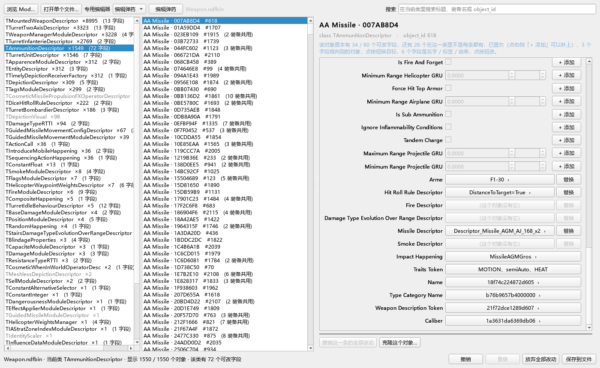

它们显示成按钮，点开是**三种不同的界面**。都不是输入框——原因见下。

### 字符串：只能换成已有的名字

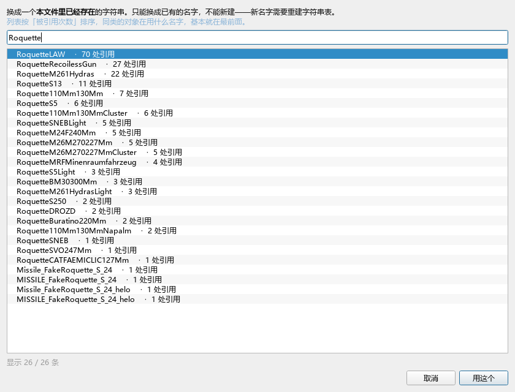

`ImpactHappening` 这类字段在文件里存的是**字符串表的一个下标**，不是文本本身。
所以：

- **不能手打一个新名字**。表里没有的名字写进去游戏也认不出；要新增名字得重建
  整张字符串表，那是另一件事（写回链路对它是原样透传的）。
- **列表按「被引用次数」排序，不是字母序**。表里有 5734 个字符串，而弹药用到的
  特效名只有几十个。你想找 `RoquetteRecoilessGun` 时，真正有用的问题是
  「同类的弹药在用什么」——而那些名字恰好都是高频的。

### 一串标签：这个可以增删

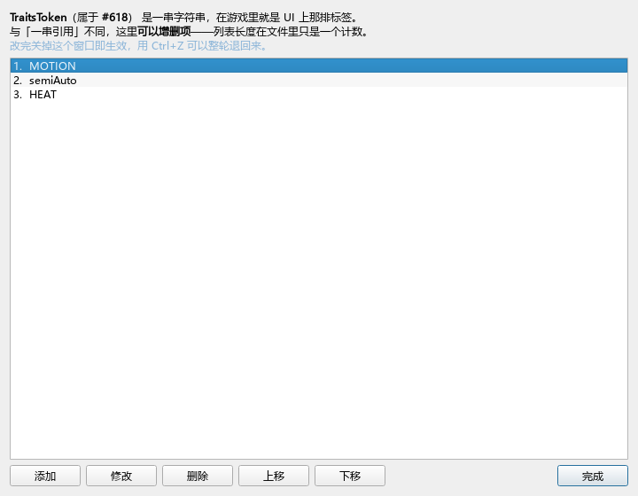

`TraitsToken` 就是 UI 上那排标签（`HE` / `HEAT` / `TANDEM` / `KINETIC` …）。
和上一节的「一串引用」不同，**这里可以增删项**——列表长度在文件里只是一个计数，
编码时会校验它等于项数，改对了就行。而「去掉 `TANDEM`」本来就是最常见的那种改动。

顺序也有意义（标签按顺序排），所以给了上移 / 下移。

### 哈希：只能照抄

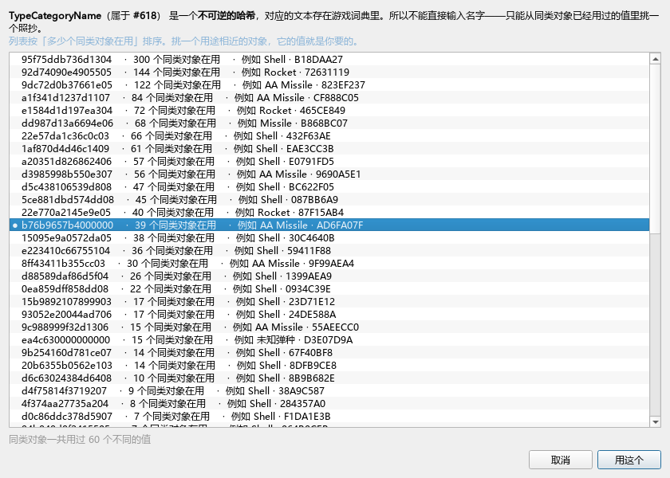

`Name`、`Caliber`、`TypeCategoryName` 存的是 8 字节**哈希**，对应的文本在游戏
词典里、而词典是加密的——所以**哈希不可逆**。

没有「输入一个名字」这种操作。能做的只有**照抄同类对象已经用过的值**。
所以这个界面列的是同类对象实际用过哪些哈希，每行配上「多少个同类在用」和一个例子。
只给一串十六进制让人挑是没有意义的；「有 300 个同类对象在用」才是判断依据。

### 实战：把 HEAT 弹改造成高爆弹

这三类字段存在的理由就是这个。完整教程见
[`弹药Arme勘查报告.md`](弹药Arme勘查报告.md) 第七节，这里只给结论：

**只改 `Arme` 是不够的。** `Arme` 只管伤害系数，「游戏怎么描述这个弹药」
由另外几个字段独立决定。实测把 RPG-29 的 HEAT 弹改了 `Arme` 之后：
对步兵可开火 ✓、打不动装甲 ✓，但 UI 仍写 `HEAT`、仍显示穿深、爆炸特效没变
——因为它只改了一个字段。

| 字段 | 从 | 改成 | 控制什么 |
|---|---|---|---|
| `Arme` | `ap_missile` | `he (9,1)` | 伤害系数 |
| `TypeCategoryName` | `a20351d826862406` | `95f75ddb736d1304` | **UI 类别名（HEAT 的来源）** |
| `TraitsToken` | `[STAT, HE, TANDEM]` | 去掉 `TANDEM` | UI 特性标签 |
| `PiercingWeapon` | `True` | 关掉 | **UI 是否显示穿深** |
| `ImpactHappening` | `RoquetteLAW` | `RoquetteRecoilessGun` | **爆炸特效** |

**后四项的值不用自己想**——找一个同类武器的现成高爆弹照抄即可。实测有
**9 个**步兵反坦克武器的高爆弹，它们这四项**完全一致**（见勘查报告 7.4 的参照表）。
改完一次 `Ctrl+Z` 能整轮退回来。

---

## 弹药专用编辑器：按值筛选 + 批量改

顶栏 **「专用编辑器」下拉框 → 编辑弹药**。

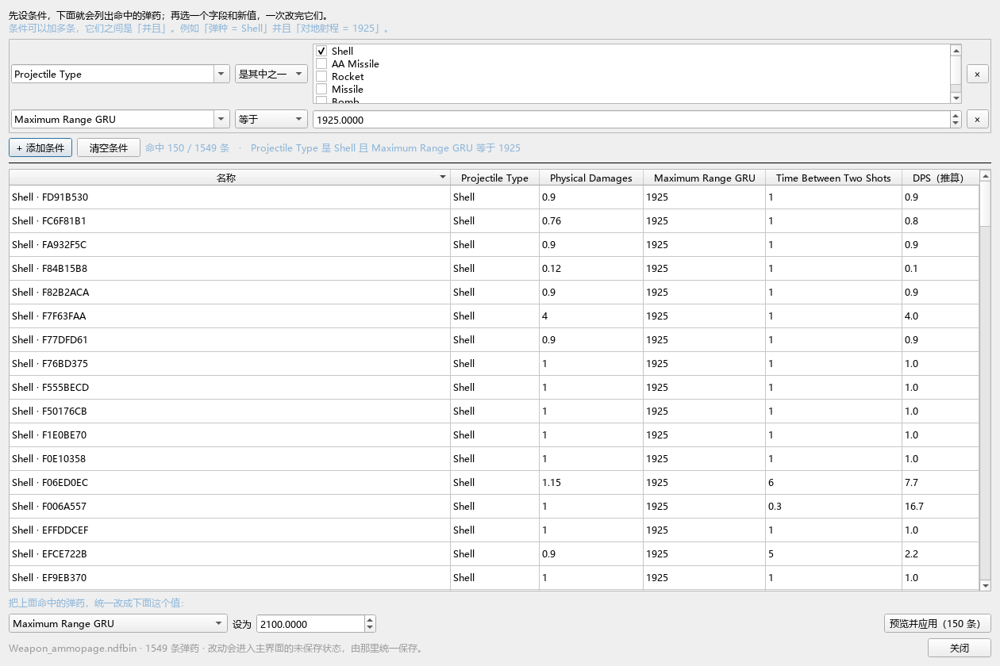

### 它解决什么

通用三栏要求你先选「类」，而 `TAmmunitionDescriptor` 这个名字对玩家没有意义。
这个页面进去直接看到 1548 条弹药和它们的弹种 / 伤害 / 射程 / DPS。

### 三步

1. **设条件** —— 可以加多条，之间是「并且」
2. **看命中** —— 列表实时更新
3. **批量改** —— 选字段、填新值、「预览并应用」

以你的例子（把对地射程 1925 的 Shell 提升到 2100）：

| 步骤 | 操作 | 结果 |
|---|---|---|
| 条件 1 | Projectile Type 是 `Shell` | 命中 857 条 |
| 条件 2 | Maximum Range GRU 等于 `1925` | 命中 **150** 条 |
| 批量改 | Maximum Range GRU 设为 `2100` | 150 条一次改完 |

> 只按射程 1925 筛会命中 **152** 条——里面混着 2 条 AA Missile。
> 这就是「弹种」必须能作为条件的原因。

### 匹配方式随字段类型自适应

| 字段 | 给的匹配方式 | 为什么 |
|---|---|---|
| 弹种这类低基数（≤12 种取值） | 「是其中之一」+ 勾选列表 | 一共 6 种，让你手输 `1` 不合理 |
| 射程、伤害这类数值 | 等于 / 不小于 / 不大于 / 在区间内 | — |
| 是/否 字段 | 等于 | — |

**float 按显示精度比较**：`PhysicalDamages` 的 float32 实际值是
`0.13199999928474426`，你在界面上看到 `0.132`、照着输入也能命中。

### 批量改只有一种模式：设为固定值

不做「加一个数」「乘系数」。需求里没出现过这种用法，
而多一个模式就多一次选错的机会。

### DPS 列是推算的，不是文件里的值

`单发伤害 × 每轮弹量 × 同时弹丸数 ÷ 射击间隔`。
改伤害或射速时它能立刻给出反馈——否则你没法判断自己改得对不对。
缺任何一个乘数就显示 `—`，不猜。

### 保存前有逐字段对照

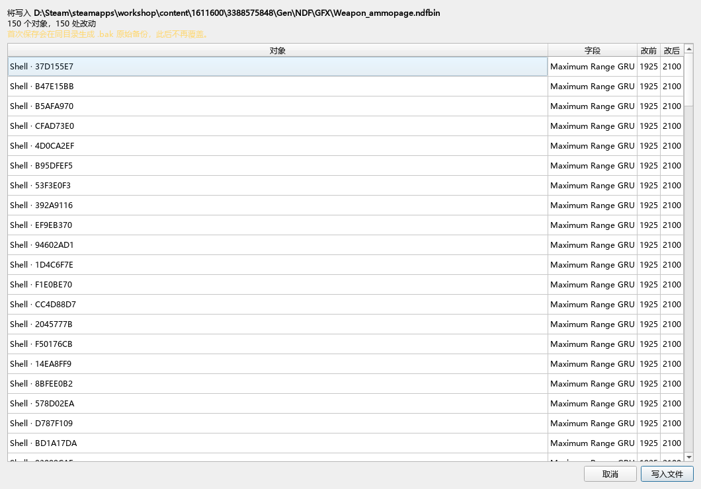

「已改动 150 个对象」说服不了一个正要按保存的人。所以保存前会列出每一处：
`Maximum Range GRU: 1925 → 2100`。**批量操作尤其需要这一步**——
条件里错一个数字，改掉的可能完全是另外 150 条，而数量看起来一模一样。

---

## 关于 GRU

游戏内部的长度单位，弹药面板上以 `*GRU` 结尾的字段旁会显示实时换算
（`≈ 6.00 km`）。**只做显示，不改存储值**——游戏读的就是 GRU。

---

## 实体视图：血量 / 装甲 / 速度

打开 `Unit.ndfbin`，选 `TEntityDescriptor`，右侧会多出一块**实体概览**。

### 为什么不是给 TEntityDescriptor 做面板

实测 4626 个实体，每个身上只有 4 个属性：

| 属性                   | 是什么          |
| -------------------- | ------------ |
| `DescriptorId`       | guid，不可改     |
| `ModulesDescriptors` | 一个列表，指向十几个模块 |
| `ClassNameForDebug`  | 调试名          |
| `World`              | 只有 936 个有    |


**实体自己没有任何数值。** 血量在 `TBaseDamageModuleDescriptor`、  
装甲在 `TDamageModuleDescriptor` + `TBlindageProperties`、速度在  
`TLandMovementModuleDescriptor` / `TGenericMovementModuleDescriptor`。

所以实体视图是顺着模块列表把这些字段**捞出来放在一起**，  
按语义分组：生存/血量、装甲、机动/速度、武器/射击、侦察/视野、  
隐蔽/电子战、后勤/补给、乘员/步兵。`Descriptor_Unit_2K11_KRUG_DDR`  
实测有 48 个模块。

分组只是**排序提示**，不是过滤：匹配不上分组的字段全进「其他模块字段」，  
一个都不会丢。这样换个 mod、换个文件，视图不会因为没见过的字段名而变空。

### 改之前先看「共用」

**这是实体视图最该被读的一句话。** 模块是共享的——实测  
`Descriptor_Unit_2K11_KRUG_DDR` 的 48 个模块里有 36 个是共用的，  
最广的 `TLinkTeamModuleDescriptor` 被 3690 个实体共用。

改这样的模块，等于改了那 3690 个实体。所以：

- 每个模块标题上都标了 `⚠ N 个实体共用`。
- 面板顶部会汇总「有 N 个模块是共用的」，并指出最广的那个。
- 只被当前实体用的模块标「独享」，改它才是安全的。

### 「其他模块字段」

默认收起（通常有 20–30 个，如 `Coalition`、`InGeoDb`、`PickableObject`）。  
勾上「显示其他模块字段」可以看到全部。

### 模块在别的文件里

有些模块不在 `Unit.ndfbin` 里，而是路径引用（如  
`$/GFX/UnitConstantes/CriticalEffectModule_Vehicule_ArmeSansTourelle`）。  
它们出现在汇总里但**不可编辑**——字段不在这个文件里就改不到。

---

## 开发者

```
ndfbin_decks/ndfedit/schema.py   # Schema 驱动内核（与文件无关）
ndfbin_decks/ndfedit/refs.py     # 引用：标签、候选集、反向索引、改写
ndfbin_decks/ndfedit/strfields.py # 文本/哈希字段：strg_ref、字符串列表、loc_hash
ndfbin_decks/ndfedit/entity.py   # 实体聚合视图（模块 → 血量/装甲/速度）
ndfbin_decks/ndfedit/modpicker.py # 先选 Mod、再选文件
ndfbin_decks/ndfedit/ammo.py     # 弹药视图：标题 / 装备归属 / 共用统计
ndfbin_decks/ndfedit/ammo_page.py # 弹药专用页：按值筛选 + 批量改
ndfbin_decks/ndfedit/query.py    # 筛选与批量改写内核
ndfbin_decks/ndfedit/history.py  # 撤销 / 重做（脏状态差分）
ndfbin_decks/ndfedit/gui.py      # 三栏界面 + 各类对话框
ndfbin_decks/io/modlocator.py    # Mod 定位（与 NdfbinDecksEditor 共用同一份）
run_weapon_editor.py             # 入口
tests/test_ndfedit_ui.py         # 40 项冒烟测试（覆盖 4 个文件）
tests/test_add_field.py          # 39 项，补加字段
tests/test_refs.py               # 106 项，引用编辑 + 实体视图 + 列表引用
tests/test_query.py              # 52 项，筛选与批量改写内核
tests/test_ammo_page.py          # 58 项，弹药专用页
tests/test_history.py            # 139 项，撤销 / 重做
tests/test_clone_and_refs.py     # 92 项，引用行两按钮 + 对象钻取 + 克隆 + 改指向
tests/test_strfields.py          # 81 项，字符串 / 标签 / 哈希三类字段
tests/test_reflist_edit.py       # 57 项，一串引用的增删与查看
tests/test_modpicker.py          # 50 项，Mod 两级选择
tools/probe_refs*.py             # 引用勘查（5 轮，产出本文的设计依据）
tools/probe_listrefs.py          # 列表型引用的长度分布勘查
tools/probe_bulk.py              # 射程/伤害取值分布勘查（批量改的设计依据）
tools/probe_add_ammo.py          # 对象能不能新增的勘查（克隆功能的依据）
tools/probe_arme.py              # 弹药 Arme 的勘查（伤害矩阵、家族名、表现层）
tools/check_editable.py          # 属性名白/黑名单的回归检查
tools/gen_field_map.py           # 生成《通用字段地图.md》
tools/screenshot_ndfedit.py      # 离屏截图（17 张）
ndfbin_decks/_weapons_legacy/    # 旧第一版实现，已归档
```


### Mod 定位为什么直接搬 NdfbinDecksEditor 的

`ndfbin_decks/io/modlocator.py` 与 NdfbinDecksEditor 里那份**逐字节相同**。
它已经把三件麻烦事解决过了，重写一遍只会重新踩一遍：

1. **两个部署根**。订阅的 Mod 不在本机工作区里，只认后者会让
   「我订阅的 Mod 怎么不在列表里」成为每个人的第一个问题。
2. **Steam 库不在 C 盘**。靠 `libraryfolders.vdf` 找，注册表只是线索之一
   而不是必需（非 Windows 开发机上不能因为没有 `winreg` 就崩）。
3. **同一个 Mod 从两处发现**。按解析后的真实路径去重。

这一层只加了一件事：**在这个 Mod 里找出可编辑的文件**。

扫描本身有性能陷阱：`rglob` 整棵树在有的 Mod 上会卡死——实测一个地图 Mod
的目录里塞着几 GB 的资源，而它一个 ndfbin 都没有。所以改成三级退让 +
深度/条目上限：先 `Gen/NDF`（正常都在这）、再 `Gen`、最后整个 Mod 根
（条目上限 3 万）。实测 16 个 Mod 全部扫完 0.02 秒，而原来会卡住。

### 引用系统为什么这么设计

勘查了 4 个文件（`tools/probe_refs*.py`、`probe_listrefs.py`）后得到的五条硬约束：

1. **引用分两类，编码不同。** `obj_ref`（`0xBBBBBBBB`）是「本文件内  
   第 N 号对象 + 它的类」两个 u32；`trans_ref`（`0xAAAAAAAA`）是 IMPR  
   前缀树的一个**节点下标**。两者都是整数，所以极易混用——  
   `TerrainSpeedFactors` 就曾被当成 object_id 显示成「#73 某个对象」。  
   所有读引用都必须走 `refs.describe()`。
2. **`obj_ref` 改目标必须连 `class_id` 一起改。**  
   `cndf_codec.decode` 会校验 `object_class_ids[object_id] == class_id`，  
   只改一半整个文件解不开。测试里专门构造了这个错误来证明校验存在。
3. **候选集规模差距 1000 倍。** 装甲等级 5–62 个，伤害类型 94 个，  
   弹药 1548 个，单位路径 6728 条。所以不做「小下拉 / 大搜索」的分支——  
   两套界面等于让玩家学两次，而分支条件他看不见。
4. **大多数目标没有名字。** Weapon.ndfbin 的 24168 个对象里只有 3564 个  
   有导出名。所以标签必须逐级回退，而不是取某一个固定字段。
   **「借被引用者的标签」必须排在「字段组合摘要」前面**——否则
   `TDeckPackDescriptor` 会显示成 `ExperienceLevel=1 Number=999`，
   而它其实指着一个真实单位。
5. **列表能不能铺开，取决于长度。** 97.5% 的列表引用长度 ≤ 8，
   但 `DeckPackList` 中位数 77、最大 268，`ModulesDescriptors` 中位数 46。
   所以列表走独立对话框而不是在面板里铺开。
   而且 `ModulesDescriptors` 混着 **77 种**目标类，
   候选集必须按**每一项**算，不能给整个列表一个统一候选集。

### 实体视图为什么不是「给 TEntityDescriptor 做面板」

那个类身上只有 4 个属性，其中 2 个是 guid 和列表，**一个数值都没有**。  
真正的数值都在 `ModulesDescriptors` 指向的模块上。所以视图的做法是  
穿透一层把模块的字段聚合起来，并按属性名做语义分组。

分组规则是**子串匹配 + 兜底**，不是白名单：匹配不上的进「其他模块字段」，  
一个都不丢。理由和字段发现一样——白名单会在换文件的那一刻失效。

「共用」是这里最重要的信息：实测一个实体 48 个模块里 36 个是共享的，  
最广的被 3690 个实体共用。改共享模块等于改那 3690 个。

### 为什么能兼容所有 ndfbin

每个 `.ndfbin` 自带 PROP 表，而PROP 表每条记录都带所属 `class`：

```python
{'id': 5, 'name': 'PhysicalDamages', 'class_id': 12,
 'class': 'TAmmunitionDescriptor'}
```

也就是说「这个类有哪些数值字段」**文件自己知道**。遍历 PROP 表即可得到，  
结果永远和文件一致——换文件、换 mod、换游戏版本都不需要改代码。

第一版把 9 个字段硬编码在 `FIELD_SPECS` 里，换个文件就全失效。

### 编辑闭环的关键设计

`Field.leaf` / `RefField.leaf` 直接指向 `decoded["objects"]` 里的原位 dict。  
改它就是改数据，不需要任何回写映射。

实体视图里改的是**模块条目**上那份共享的 `ObjEntry`，所以改动直接落在  
模块对象原位——不会出现「视图里改了、文件里没改」。

### 撤销栈为什么是「差分」而不是「命令对象」

命令模式是这里的自然选择：每个改动点记一条 `(目标, 旧值, 新值)`，
`undo()` 写回旧值。但**改数据的落点有六处**——标量编辑、实体聚合行编辑、
换引用目标、换一串引用里的某一项、补加/摘掉字段、批量设值。
任何一处忘了上报，栈就和真实状态错开；而错开的后果是
**撤销之后文件停在一个谁都没预料到的状态**，比没有撤销更糟。

`ndfbin_decks/ndfedit/history.py` 改成**脏状态差分**：每次改动后重扫
「当前有哪些字段偏离了原值」，与上一次快照比对，差出来的就是这一步。

- 不可能失同步——差分直接读文档本身，不依赖任何上报点。
- 批量改 150 条天然是**一步**，不用手工包一层复合命令。
- 结构改动自动包含：补加/摘掉字段在快照里以「这个键在不在」表达。

代价是每次提交扫一遍全文件（Weapon.ndfbin 24168 个对象 / 122621 个字段
约 50ms，Unit.ndfbin 约 65ms）。这个扫描**顺带算出了状态栏要的全部计数**，
替代了原先分开跑的五次全量扫描，所以净代价接近零。

三个配套设计：

| 机制 | 为什么 |
|---|---|
| 合并窗口 1.5 秒 | 方向键连点 20 下改射程不该要按 20 次 Ctrl+Z。只有状态键集完全相同且窗口内才合并，所以「改完 A 改 B 再回来改 A」仍是三步 |
| 净零步骤丢弃 | 改出去又改回原样，不在历史里留一格什么也不干的记录 |
| `break_merge()` | 「撤销这一条的全部改动」这种明确动作必须单独成步——刚才退过一次、紧接着点它，两下净效果为零，会被窗口吃成「不留记录」，那次点击就永远回不来了 |

撤销的边界是 `snapshot()` 里记录的东西：字段值、引用节点的
`object_id + class_id`、列表项的同一组键，以及「这个字段在不在」。
测试里用 `encode_objects` 的**字节序列**做等价判定，不是比几个字段——
差一个字节就说明有东西没退干净。

### 克隆对象为什么必须自己扩 TOPO

`cndf_codec.append_graph_objects` 是现成的对象追加器（Deck 编辑器追加 pack
就在用），它会一起扩 CLAS / PROP / CHNK 并跑一次完整 decode 校验。但它
**不动 TOPO**（`parse_u32_list` 读出来的顶层对象索引表）。

而实测 **1548 / 1548 个弹药全都在 TOPO 里**——不补的话新对象
`is_top_object` 是 False，与全部同类不一致。补测过：手动把新 id 追加到
TOPO 后 decode 通过、`is_top_object` 变 True，所以这是**追加器的缺口，
不是格式限制**。

这一步只有重新解码才看得出来：**忘了补 TOPO 时写盘不报错、读回也不报错**，
只有 `is_top_object` 会从 True 变 False。所以测试里那条断言是硬指标。

九个分区里只有 OBJE / CHNK / TOPO 需要动，`STRG` / `TRAN` / `IMPR` / `EXPR`
都不用——克隆复用已有的字符串与引入表引用，而 `EXPR` 只校验 `i < count`，
count 变大不会失效。

### 撤销栈怎么覆盖「追加了对象」

追加不是字段值的改变，脏状态差分看不见它。所以 `History` 的
`snapshot()` 里多了一个**保留槽位**（`object_id = -1`），值是「追加了几个」。
它在 `_write` 里落到 `nd.set_appended_count(n)`：

- 往前 → 从 ``_clones`` 载荷表里物化
- 往回 → 截断对象表尾部

三处配套设计：

| 机制 | 为什么 |
| --- | --- |
| 载荷表只增不减，靠 `appended_count` 索引 | 撤销要能重做回来，载荷必须留着 |
| 再做新克隆时先丢掉「已撤销」的载荷 | 否则这次物化会把玩家早就撤掉的旧对象**一起加回来**，对象数一次跳好几格 |
| 截断前用 `references_to_any` 检查 | 有引用还指着它时拒绝，把「你还有 2 处引用指着它」说清楚，而不是写出一个 decode 会拒绝的文件 |

另外 `History` 的条目查询必须**现查**（`nd.entry_of`），不能像早期版本那样
在构造时缓存一份 `{object_id: ObjEntry}`——那份缓存里没有克隆出来的对象，
玩家改克隆体的字段就撤不回来。

### 克隆完为什么保存按钮是亮的

`dirty_count()` 数的是「有脏字段的对象」，而**克隆体一个脏字段都没有**
（它的属性是复制来的，`original` 就等于当前值）。只看那个数的话，
克隆完什么都没改时保存按钮是灰的，克隆体根本存不下去。

所以 `Stats` 多了一个 `new_objects`，它**不进** `items`（那不是「改了一处」，
是「多了个对象」），但必须算作未保存改动。`on_save` 的守卫也跟着改成
`dirty_count() or appended_count()`。

### 跑测试

```bash
python -m tests.test_ndfedit_ui    # 40 项，含 Weapon/Unit/Deck/Division
python -m tests.test_writer        # 20 项，写回安全性
python -m tests.test_add_field     # 39 项，补加字段机制
python -m tests.test_refs          # 106 项，引用编辑 + 实体聚合 + 列表引用
python -m tests.test_query         # 52 项，筛选与批量改写内核
python -m tests.test_ammo_page     # 58 项，弹药专用页（含真实落盘）
python -m tests.test_history       # 139 项，撤销 / 重做
python -m tests.test_clone_and_refs # 92 项，引用行两按钮 + 对象钻取 + 克隆 + 改指向
python -m tests.test_strfields    # 81 项，字符串 / 标签 / 哈希三类字段
python -m tests.test_reflist_edit # 57 项，一串引用的增删与查看
python -m tests.test_modpicker     # 50 项，Mod 两级选择
```


> `test_divisions` / `test_unit_universe` 要用 `python -m tests.xxx` 运行，
> 直接 `python tests/xxx.py` 会因为 `sys.path` 缺项目根而报
> `ModuleNotFoundError`。这是测试入口的问题，不是失败。
>
> **测失败路径前必须拦掉模态框。** 离屏环境下 `QMessageBox.*` 与
> `ChangePreviewDialog.exec()` 都会**永久阻塞**，测试直接挂死
> （这个坑已踩三次：坏文件提示、保存前预览）。测保存流程时要么换掉
> `exec`，要么直接调 `nd.save()` 绕开界面。